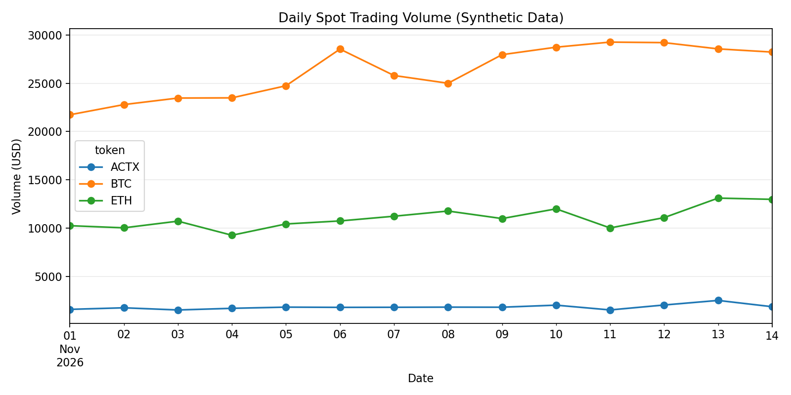
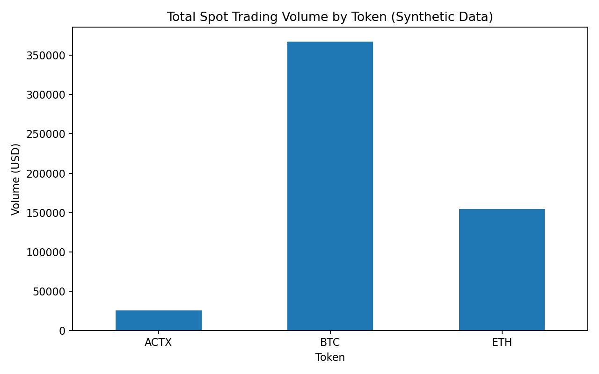
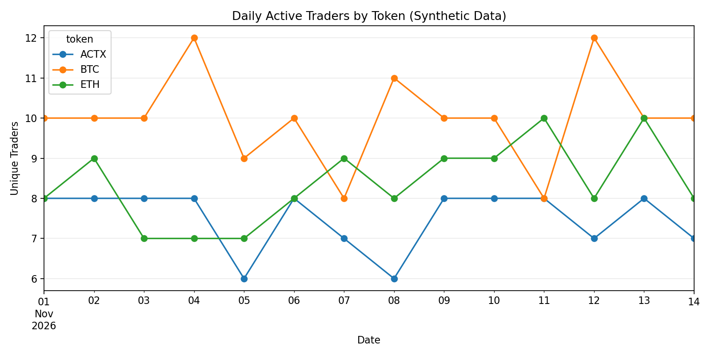

# Crypto Spot Trading Analytics

A beginner-friendly **Python + Pandas** portfolio project that reproduces common SQL aggregations for spot crypto trading data.

> **Data notice:** All transactions, user IDs, and token activity in this repository are synthetic. They do not represent real exchange activity.

## KPIs

- **Total trading volume (USD):** Sum of trade notional values for the selected token.
- **Total trades:** Number of trade records for the selected token.
- **Active traders:** Number of unique user IDs with at least one trade in the selected token.

## Project structure

```text
crypto-spot-trading-analytics/
├── analysis.py
├── data/
│   └── trades.csv
├── requirements.txt
├── .gitignore
└── README.md
```

## Quick start

Requires Python 3.10+.

```bash
python -m venv .venv
source .venv/bin/activate  # On Windows: .venv\Scripts\activate
pip install -r requirements.txt
python analysis.py
```

The script prints the input transactions and KPI summary, and writes `actx_summary.csv` locally.

## Expected ACTX results

| Token | Total Volume (USD) | Total Trades | Active Traders |
|---|---:|---:|---:|
| ACTX | 8,000 | 4 | 3 |

## SQL-to-Pandas mapping

| SQL | Pandas |
|---|---|
| `WHERE token = 'ACTX'` | `df.loc[df['token'] == 'ACTX']` |
| `SUM(volume_usd)` | `selected['volume_usd'].sum()` |
| `COUNT(*)` | `len(selected)` |
| `COUNT(DISTINCT user_id)` | `selected['user_id'].nunique()` |

## Notes

The current dataset is intentionally small and only demonstrates three basic KPIs. It does **not** yet measure retention, liquidity, campaign ROI, or asset growth over time. Future extensions could add timestamps, fee revenue, order-book snapshots, and campaign attribution.

## Phase 2: Spot Trading Dashboard

This dashboard compares BTC, ETH, and ACTX
using synthetic trading data.

### Daily Trading Volume


### Total Volume by Token


### Daily Active Traders


### Run the Dashboard
